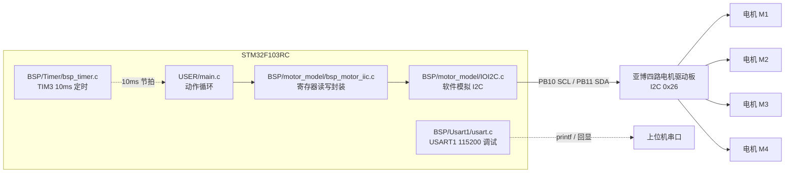
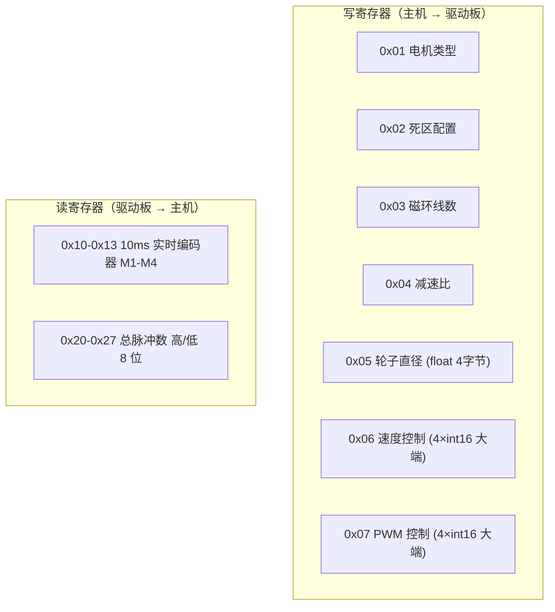
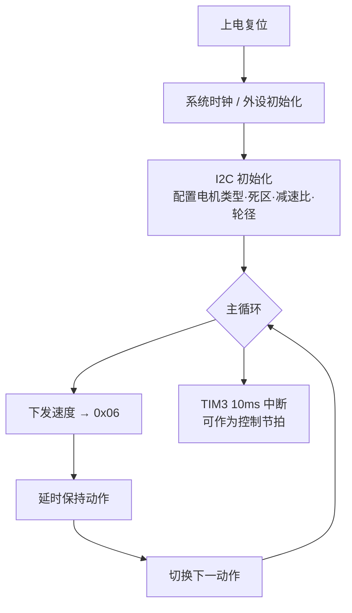

# CarMove_IIC：STM32F103 软件模拟 I2C 驱动四路霍尔电机小车

基于 STM32F103RC 的四轮小车电机控制例程：用**软件模拟 I2C** 驱动亚博（Yahboom）四路电机驱动板，实现前进 / 后退 / 转向 / 停止的动作循环，并通过 USART1 输出调试信息。

> 一句话概括：这不是一个完整的机器人工程，而是**「STM32 如何用 I2C 跟电机驱动板对话」的最小可跑通示例**。

**在整个体系里的位置**：本仓是 MCU 板端固件层，链路为 `STM32F103RC → 软件 I2C → 亚博四路驱动板 → M1~M4 霍尔电机`；上位机、ROS 2 节点、串口协议解析等上层实现都不在本仓。事实包中没有发现任何跨仓链接、submodule 或对其他仓库的引用，因此不臆造关联仓库，仅给出本仓地址 <https://github.com/DLDLDL13579/CarMove_IIC>。

## 现状 / 状态表

| 项 | 状态 | 依据 |
|---|---|---|
| 仓库全名 | `DLDLDL13579/CarMove_IIC` | GitHub 元数据 |
| 可见性 | 公开 | GitHub 元数据 |
| 默认分支 | `master` | GitHub 元数据 |
| 主语言 | C | GitHub 元数据 |
| 仓库体积 | 270 KB | GitHub 元数据 |
| star / fork | 1 / 0 | GitHub 元数据 |
| 创建日期 | 2025-08-03 | GitHub 元数据 |
| 最后 push | 2026-09-17 | GitHub 元数据 |
| GitHub 描述 | `stm32f103rct6和四路驱动板的霍尔电机小车项目` | GitHub 元数据 |
| 文件总数 | 74 个；一级分布 `FWLib:46, BSP:12, USER:8, CMSIS:6, (根文件):2` | GitHub 元数据 |
| LICENSE | 根目录无 LICENSE 文件 | GitHub 元数据 |
| 当前基线 | 单文件 `while(1)` 动作循环例程，非完整机器人工程 | `USER/main.c` + 现有 README |

**已完成**：软件 I2C 时序、驱动板寄存器读写封装、按电机型号初始化、5 状态动作循环、编码器回读与串口打印、TIM3 节拍。

**未完成**：命令行构建脚本、上位机控制协议、闭环速度控制、单元测试、仓库级 LICENSE；旧 README 描述的 Keil 工程文件未在可见文件树中确认（见「已知问题」）。

## 硬件与开发环境

| 项 | 值 | 依据 |
|---|---|---|
| MCU | STM32F103RC（GitHub 描述写作 `stm32f103rct6`） | 现有 README「硬件与开发环境」+ 元数据「GitHub 描述」；两处命名口径不同，见「已知问题」 |
| 开发环境 | Keil MDK（uVision） | 现有 README，工程文件 `I2C.uvprojx` / `I2C.uvoptx` |
| 启动文件 | `startup_stm32f10x_hd.s` | 现有 README，标注位于 `CMSIS/` |
| 外设库 | STM32F10x 标准外设库（FWLib） | 文件树 `FWLib/inc`、`FWLib/src` 共 46 个文件 |
| 电机驱动板 | 亚博四路电机驱动板，I2C 从机地址 **0x26** | 现有 README，标注出自 `BSP/motor_model/bsp_motor_iic.h` |

> 上表除「文件树」一列外，具体值均来自现有 README 的转述。本事实包的「关键文件原文」只提供了 `.gitignore`、`README.md`、`USER/main.c` 三份文件，未提供 `bsp_motor_iic.h`、工程文件等源码，因此这些值未获逐字复核，详见「参数表（二）」与「已知问题」。

## 系统结构



> 图中的 `0x26`、PB10/PB11、115200、10ms 等数值沿用现有 README 的表述，本事实包未提供对应驱动源码原文；图中出现的 5 个模块文件均可在真实文件树中找到。

## 目录说明

以下为事实包可见的真实文件树（逐行列出 72 条；元数据声明仓库共 74 个文件，差额为文件树节选未列出的文件，见「已知问题」）：

| 目录 / 文件 | 可见文件数 | 内容 |
|---|---|---|
| 根文件 | 2 | `.gitignore`（Keil 产物与 macOS 伴生文件忽略项）、`README.md` |
| `BSP/` | 12 | 板级驱动。`BSP/bsp.c/.h`；`Delay/delay.c/.h`；`Timer/bsp_timer.c/.h`；`Usart1/usart.c/.h`；`motor_model/IOI2C.c/.h`、`bsp_motor_iic.c/.h` |
| `CMSIS/` | 5 | `core_cm3.c/.h`、`stm32f10x.h`、`system_stm32f10x.c/.h` |
| `FWLib/` | 46 | ST 标准外设库，`inc/` 23 个头文件 + `src/` 23 个实现文件 |
| `USER/` | 7 | `AllHeader.h`、`main.c`、`motor_control.h`、`myenum.h`、`stm32f10x_conf.h`、`stm32f10x_it.c/.h` |

各目录作用：

| 目录 | 内容 |
|---|---|
| `USER/` | 应用入口 `main.c`、中断服务函数 `stm32f10x_it.c`、全局头 `AllHeader.h` / `motor_control.h` / `myenum.h`、外设库配置 `stm32f10x_conf.h`；现有 README 称 Keil 工程文件也在此目录 |
| `BSP/` | 板级驱动：`Delay/`、`Timer/`（TIM3）、`Usart1/`、`motor_model/`（软件 I2C 与电机寄存器封装） |
| `CMSIS/` | Cortex-M3 内核与器件头文件、系统时钟实现 |
| `FWLib/` | STMicroelectronics STM32F10x 标准外设库（inc / src） |

## I2C 寄存器协议

驱动板通过寄存器读写交互。以下映射来自现有 README 对 `bsp_motor_iic.h` 的转述：



- 速度 / PWM 寄存器（0x06 / 0x07）数据为 **4 个 int16，大端，共 8 字节**
- 编码器值由驱动板侧读取，MCU 通过 0x10–0x13 取 10ms 内的实时值
- 总脉冲数分高 / 低 8 位两个寄存器存放（0x20/0x21 为 M1，以此类推）

> 上述寄存器编号与数据格式未在本次事实包中取得 `bsp_motor_iic.h` 原文，属于现有 README 的转述，改动驱动逻辑前请回查头文件。

## 关键实现：为什么用编译期宏而不是运行时配置

`USER/main.c` 用两个编译期宏把「电机型号」和「编码器上报通路」全部固化在编译阶段。这是最小例程的典型取舍：MCU 侧不需要运行时参数解析，也不需要配置文件，换电机只需改一个宏后重新编译；代价是同一份固件不能自适应不同驱动板。

以下片段节选自事实包中 `USER/main.c` 的逐字原文（注释里的 `?` 是原文件乱码，见「已知问题」）：

```c
#include "AllHeader.h"

#define UPLOAD_DATA 2  //1:????????? 2:????????
#define MOTOR_TYPE 1   //1:520?? 2:310?? 3:????TT?? 4:TT?????? 5:L?520??

uint8_t times = 0;
uint8_t upload_counter = 0;

void Car_Move(void)
{
    static uint8_t state = 0;
    switch(state)
    {
        case 0:
        control_speed(300,300,300,300);
        break;
        case 1:
        control_speed(-300,-300,-300,-300);
        break;
        case 2:
        control_speed(300,300,-600,-600);
        break;
        case 3:
        control_speed(-600,-600,300,300);
        break;
        case 4:
        control_speed(0,0,0,0);
        break;
    }
    state++;
    if(state>4)state=0;
}
```

`MOTOR_TYPE` 决定上电时写哪一组驱动板参数，分支之间用 `delay_ms(100)` 隔开，保证每条 I2C 配置事务有间隔：

```c
int main(void)
{
    bsp_init();
    TIM3_Init();
    IIC_Motor_Init();
    printf("pelase wait...\r\n");
    control_pwm(0,0,0,0);
    delay_ms(1000);

    #if MOTOR_TYPE == 1
    Set_motor_type(1);
    delay_ms(100);
    Set_Pluse_Phase(30);
    delay_ms(100);
    Set_Pluse_line(11);
    delay_ms(100);
    Set_Wheel_dis(67.00);
    delay_ms(100);
    Set_motor_deadzone(1900);
    delay_ms(100);
    /* ... MOTOR_TYPE == 2 / 3 / 4 / 5 分支略 ... */
    #endif
```

主循环把「动作切换」和「编码器上报」拆成两个软件计数器，都靠 `delay_ms(10)` 推进；实际节拍还包含 I2C 事务与 `printf` 耗时，因此不是精确定时：

```c
while(1)
{
    if(times >= 250)
    {
        #if MOTOR_TYPE == 4
        Car_Move_PWM();
        #else
        Car_Move();
        #endif
        times = 0;
    }

    if(upload_counter >= 2)
    {
        #if UPLOAD_DATA == 2
        Read_10_Enconder();
        printf("M1:%d\t M2:%d\t M3:%d\t M4:%d\r\n",
               Encoder_Offset[0], Encoder_Offset[1],
               Encoder_Offset[2], Encoder_Offset[3]);
        #else
        Read_ALL_Enconder();
        printf("M1:%d\t M2:%d\t M3:%d\t M4:%d\r\n",
               Current_Speed[0], Current_Speed[1],
               Current_Speed[2], Current_Speed[3]);
        #endif
        upload_counter = 0;
    }

    delay_ms(10);
    times++;
    upload_counter++;
}
```

`UPLOAD_DATA == 2` 走 `Read_10_Enconder()` 打印 `Encoder_Offset[]`，否则走 `Read_ALL_Enconder()` 打印 `Current_Speed[]`——这是旧 README 完全没有提到的两条数据通路。`MOTOR_TYPE == 4` 走 `Car_Move_PWM()`，其余走 `Car_Move()`，两个动作函数在任一编译配置下都有一个不可达。

## 参数表（一）：`USER/main.c` 逐字可证

| 参数 / 常量 | 值 | 单位 / 含义 | 出处 |
|---|---|---|---|
| `UPLOAD_DATA` | `2` | 编译期选择编码器上报通路 | `USER/main.c` |
| `MOTOR_TYPE` | `1` | 编译期选择电机型号配置分支 | `USER/main.c` |
| `times >= 250` | 250 | 动作切换计数阈值，源码注释按 `250 * 10ms` 估算 2.5 秒 | `USER/main.c` |
| `upload_counter >= 2` | 2 | 编码器读取计数阈值，源码注释按 `10ms*2` 估算 20ms | `USER/main.c` |
| `delay_ms(10)` | 10 | ms，主循环末尾延时 | `USER/main.c` |
| `delay_ms(1000)` | 1000 | ms，上电后等待 | `USER/main.c` |
| `delay_ms(100)` | 100 | ms，每条 `Set_*` 配置之间的间隔 | `USER/main.c` |
| `control_pwm(0,0,0,0)` | 0 | `main()` 初始化阶段下发四路全 0；函数语义未在事实包中给出定义 | `USER/main.c` |
| `Car_Move()` 四轮速度 | `300,300,300,300` / `-300,-300,-300,-300` / `300,300,-600,-600` / `-600,-600,300,300` / `0,0,0,0` | 5 个状态循环 | `USER/main.c` |
| `Car_Move_PWM()` 四路 PWM | `1500,1500,1500,1500` / `-1500,-1500,-1500,-1500` / `1200,1200,-1500,-1500` / `-1500,-1500,1200,1200` / `0,0,0,0` | 5 个状态循环 | `USER/main.c` |
| `Set_motor_type` | `1` | `MOTOR_TYPE == 1` 分支 | `USER/main.c` |
| `Set_Pluse_Phase` | `30` | 同分支；函数与寄存器含义未在事实包中给出定义 | `USER/main.c` |
| `Set_Pluse_line` | `11` | 同分支；函数与寄存器含义未在事实包中给出定义 | `USER/main.c` |
| `Set_Wheel_dis` | `67.00` | 同分支；函数与寄存器含义未在事实包中给出定义 | `USER/main.c` |
| `Set_motor_deadzone` | `1900` | 同分支 | `USER/main.c` |
| `Set_motor_type` 各分支 | `1 / 2 / 3 / 4 / 1` | `MOTOR_TYPE` 1~5 档分别写入 | `USER/main.c` |
| `Set_Pluse_Phase` 各分支 | `30 / 20 / 45 / 48 / 40` | `MOTOR_TYPE` 1~5 档 | `USER/main.c` |
| `Set_Pluse_line` 各分支 | `11 / 13 / 13 / 不调用 / 11` | `MOTOR_TYPE == 4` 分支不调用 | `USER/main.c` |
| `Set_Wheel_dis` 各分支 | `67.00 / 48.00 / 68.00 / 不调用 / 67.00` | `MOTOR_TYPE == 4` 分支不调用 | `USER/main.c` |
| `Set_motor_deadzone` 各分支 | `1900 / 1600 / 1250 / 1000 / 1900` | `MOTOR_TYPE` 1~5 档 | `USER/main.c` |

## 参数表（二）：现有 README 转述，本次未获源码原文复核

| 项 | 现有 README 给出的值 | 现有 README 标注的出处 | 复核状态 |
|---|---|---|---|
| I2C 从机地址 | `0x26` | `BSP/motor_model/bsp_motor_iic.h` | 事实包未提供该文件原文，未复核 |
| 写寄存器 | `0x01`~`0x07` | `BSP/motor_model/bsp_motor_iic.h` | 未复核 |
| 读寄存器 | `0x10`~`0x13`、`0x20`~`0x27` | `BSP/motor_model/bsp_motor_iic.h` | 未复核 |
| 速度 / PWM 数据格式 | 4×int16 大端，共 8 字节 | `BSP/motor_model/bsp_motor_iic.h` | 未复核 |
| 软件 I2C 引脚 | PB10 = SCL，PB11 = SDA | `BSP/motor_model/IOI2C.c` | 未复核 |
| USART1 | PA9 / PA10，115200，仅调试打印与回显 | `BSP/Usart1/usart.c` | 未复核 |
| TIM3 | 预分频 7199、周期 99 → 10ms 定时中断 | `BSP/Timer/bsp_timer.c` | 未复核 |
| MCU 型号 | `STM32F103RC`，依据 `<Device>STM32F103RC` | `USER/I2C.uvprojx` | 完整 `git ls-tree` 复核：该文件确实存在；`<Device>` 值未在事实包展开，未逐字复核 |
| 启动文件 | `startup_stm32f10x_hd.s` | `CMSIS/startup_stm32f10x_hd.s` | 完整 `git ls-tree` 复核：确实存在 |

## 外设分配

| 外设 | 引脚 / 配置 | 文件 |
|---|---|---|
| 软件 I2C | PB10 = SCL，PB11 = SDA | `BSP/motor_model/IOI2C.c` |
| USART1 | PA9 / PA10，115200，仅调试打印与回显 | `BSP/Usart1/usart.c` |
| TIM3 | 预分频 7199、周期 99 → 10ms 定时中断 | `BSP/Timer/bsp_timer.c` |

> 现有 README 写「本例程**没有**使用编码器接口、PWM 输出或 ADC —— 电机测速与驱动全部由驱动板完成，MCU 只通过 I2C 下发目标速度并回读编码器」。这句概括需按 `main.c` 收窄：MCU 确实没有用片上定时器输出 PWM 波形，但 `main.c` 上电即调用 `control_pwm(0,0,0,0)`，且在 `MOTOR_TYPE == 4` 分支用 `Car_Move_PWM()` 下发 PWM 值；「只下发目标速度」并不成立。上表数值同样未在本次事实包中取得源码原文。

## 主流程

`USER/main.c` 在初始化后进入循环，依次执行前进、后退、转向、停止等动作；现有 README 称串口中断 `USART1_IRQHandler` 把收到的字节原样回发，用作链路自检（该中断实现位于 `USER/stm32f10x_it.c`，事实包未提供其原文）。



## 编译与烧录

前置条件：Keil MDK（uVision）、STM32F103RC 目标板、亚博四路电机驱动板与四路霍尔电机、ST-Link / J-Link 下载器、串口线（USART1 调试输出）。本仓为裸机 C 工程，不涉及 ROS 版本、Node 或 Python 版本。

1. 用 Keil uVision 打开 `USER/I2C.uvprojx`
2. 选择目标 `I2C`，编译（Build）
3. 通过 ST-Link / J-Link 下载到 STM32F103RC

> ✅ 已用完整 `git ls-tree` 复核：`USER/I2C.uvprojx` 与 `CMSIS/startup_stm32f10x_hd.s` **确实已提交**，可直接按上述三步打开工程。事实包的文件树是节选（元数据 74 个文件、清单只展开 72 条），初稿曾据此疑为漏提交，现已订正。`I2C.uvoptx` 与 `OBJ/` 在完整树中未检索到——符合 `.gitignore` 忽略 `*.uvoptx` 与 `/OBJ/` 的约定，属于本地生成物，不影响打开工程。

仓库内未提供命令行构建脚本；现有 README 称 `OBJ/` 为 Keil 编译产物目录，且 `.gitignore` 明确忽略 `*.axf`、`*.hex`、`*.o`、`*.uvoptx` 与 `/OBJ/I2C.build_log.htm` 等产物，所以仓库里不含可直接烧录的固件。

## 已知问题

| # | 问题 | 依据 | 影响 / 建议 |
|---|---|---|---|
| 1 | 事实包的文件树是节选，初稿曾据「清单未列出」误判 `USER/I2C.uvprojx` 与 `CMSIS/startup_stm32f10x_hd.s` 缺失 | 完整 `git ls-tree` 复核 vs 事实包节选清单 | **两者均已提交，构建不受影响**；本条保留为「节选清单不可作为缺失判据」的记录。`I2C.uvoptx` / `OBJ/` 属被 `.gitignore` 忽略的本地生成物，无需入库 |
| 2 | 文件树元数据（74 个文件、`USER:8` / `CMSIS:6`）与可见代码块（72 条、`USER:7` / `CMSIS:5`）相差 2 个 | 元数据 vs 文件树代码块 | 本 README 的目录清单只覆盖可见部分。`.gitignore` 中 `/USER/._I2C.uvprojx`、`/CMSIS/._startup_stm32f10x_hd.s` 是 macOS AppleDouble 伴生文件的忽略项，只能作为旁证，不能替代工程文件本身 |
| 3 | `USER/main.c` 的注释大面积乱码（`//1:?????????`、`//1:520?? 2:310??`、`//??` 等） | `USER/main.c` 逐字原文 | `MOTOR_TYPE` 各档对应哪种电机、每个 `case` 对应前进/后退/转向中的哪一个，都无法从注释读出；改动前须回查亚博原厂例程 |
| 4 | 旧 README 完全没有提到 `UPLOAD_DATA` / `MOTOR_TYPE` 两个编译期宏及其分支 | `USER/main.c` vs 现有 README | **文档描述落后于代码**：`MOTOR_TYPE == 4` 走 `Car_Move_PWM()`，其余走 `Car_Move()`；`UPLOAD_DATA == 2` 走 `Read_10_Enconder()` + `Encoder_Offset[]`，否则走 `Read_ALL_Enconder()` + `Current_Speed[]`。不读源码会以为只有速度控制一条通路 |
| 5 | `Car_Move_PWM()` 在 `MOTOR_TYPE != 4` 时不可达，`Car_Move()` 在 `MOTOR_TYPE == 4` 时不可达 | `USER/main.c` 的 `#if MOTOR_TYPE == 4` 条件编译 | 条件编译死代码，是设计取舍而非缺陷，但 README 应说明，否则读者会以为两套动作同时生效 |
| 6 | 上电打印 `printf("pelase wait...\r\n")`，`please` 拼作 `pelase` | `USER/main.c` 逐字原文 | 串口日志里按 `please` 检索不到启动标志 |
| 7 | 主循环用 `delay_ms(10)` + `times++` 估算 2.5 秒动作周期，但同一循环内还有 I2C 读写与 `printf` | `USER/main.c` 主循环 + 注释「`250 * 10ms = 2.5?`」 | 实际周期不是精确 2.5 秒；需要精确定时应依赖 TIM3 中断而非软件计数 |
| 8 | 旧 README 把 `0x26`、PB10/PB11、PA9/PA10、115200、7199/99、10ms 标注为出自 `bsp_motor_iic.h`、`IOI2C.c`、`usart.c`、`bsp_timer.c`，但本事实包未提供这些文件的原文 | 事实包「关键文件原文」只有 `.gitignore`、`README.md`、`USER/main.c` | 无法逐字复核；本 README 已在「参数表（二）」逐项降级标注，建议后续补源码引用 |
| 9 | 旧 README 概括「MCU 只通过 I2C 下发目标速度」，但 `main.c` 上电即 `control_pwm(0,0,0,0)`，且 `MOTOR_TYPE == 4` 分支调用 `Car_Move_PWM()` | `USER/main.c` vs 现有 README「外设分配」 | 「没有使用 PWM 输出」只适用于 MCU 片上引脚，不适用于驱动板的 PWM 寄存器；表述需收窄 |
| 10 | `.gitignore` 忽略 `*.uvoptx`、`*.uvgui.*`、`*.axf`、`*.hex`、`*.o` 及 `/OBJ/I2C.build_log.htm`、`/OBJ/I2C.htm` | `.gitignore` 逐字原文 | 仓库不含可烧录固件与编译日志；旧 README 说「`OBJ/` 为 Keil 编译产物目录」，但该目录产物未被提交 |
| 11 | 芯片型号命名不一致：GitHub 描述为 `stm32f103rct6`，旧 README 表格为 `STM32F103RC` | 元数据「GitHub 描述」vs 现有 README | 本事实包未提供 `USER/I2C.uvprojx` 原文，无法核对 `<Device>` 值；烧录前以实际芯片与工程配置为准 |
| 12 | 根目录无 LICENSE 文件，而源码基于亚博例程与 ST 标准外设库 | 元数据 + 现有 README「归属与许可证」 | 权利状态依赖各上游许可，必须明确「非原创 / 含上游第三方包，权利归各自原作者」，不能整体声明为自有 |
| 13 | 现有 README「代码规模」给出「约 1335 行」的估计，但事实包未提供 `BSP/` 全部源码 | 现有 README「代码规模」 | 行数未逐行复核；本 README 保留该表并标注为旧 README 估计 |

## 代码规模

| 范围 | 文件数 | 行数 |
|---|---|---|
| `BSP/` + `USER/`（本工程自研部分） | 19 个 .c/.h | 约 1335 行（旧 README 估计，本次未复核） |
| 含 `FWLib/` + `CMSIS/` | 70 个 .c/.h | — |

> 统计口径：仅 .c/.h/.s 源文件，不含 Keil 工程文件与编译产物。可见文件树中 `BSP:12 + USER:7 + FWLib:46 + CMSIS:5 = 70` 个 .c/.h，与上表第二行一致；元数据声明共 74 个文件，其中 2 个为根文件，另有 2 个为文件树节选未列出的条目。

## 归属与许可证

- **根目录无 LICENSE 文件**（GitHub 元数据）。不要依据徽章或旧 README 推断本仓整体为 MIT / Apache；目前**没有可声明的仓库级许可证**。
- **本工程非原创，内含上游第三方组件，权利归各自原作者**：
  - 现有 README 记载 `USER/AllHeader.h` 等文件带版权头 `Copyright (C) 2016-2026, Shenzhen Yahboom Tech`，作者署名 `lly`，即电机驱动例程与 I2C 寄存器协议实现来自**亚博智能（Yahboom）**。注意：本次事实包未提供 `USER/AllHeader.h` 原文，该版权头为旧 README 的转述，未逐字复核。
  - `CMSIS/`、`FWLib/` 为 STMicroelectronics 的 CMSIS 与 STM32F10x 标准外设库，遵循其原始许可；文件树中 `FWLib/` 共 46 个文件、`CMSIS/` 可见 5 个文件。
  - `BSP/motor_model/IOI2C.c/.h`、`BSP/motor_model/bsp_motor_iic.c/.h` 等板级驱动，按现有 README 的描述同属亚博例程体系，权利归原作者。
- 使用与再分发前，请分别核对亚博例程与 ST 标准外设库的许可条款；本仓未提供任何授权文件。
- 相关链接：<https://github.com/DLDLDL13579/CarMove_IIC>。
